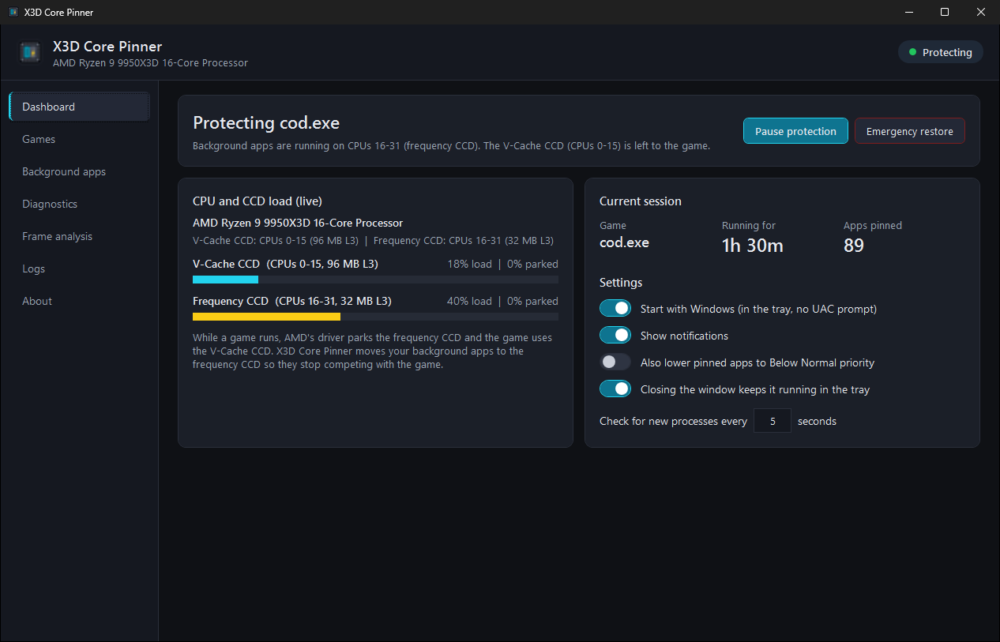
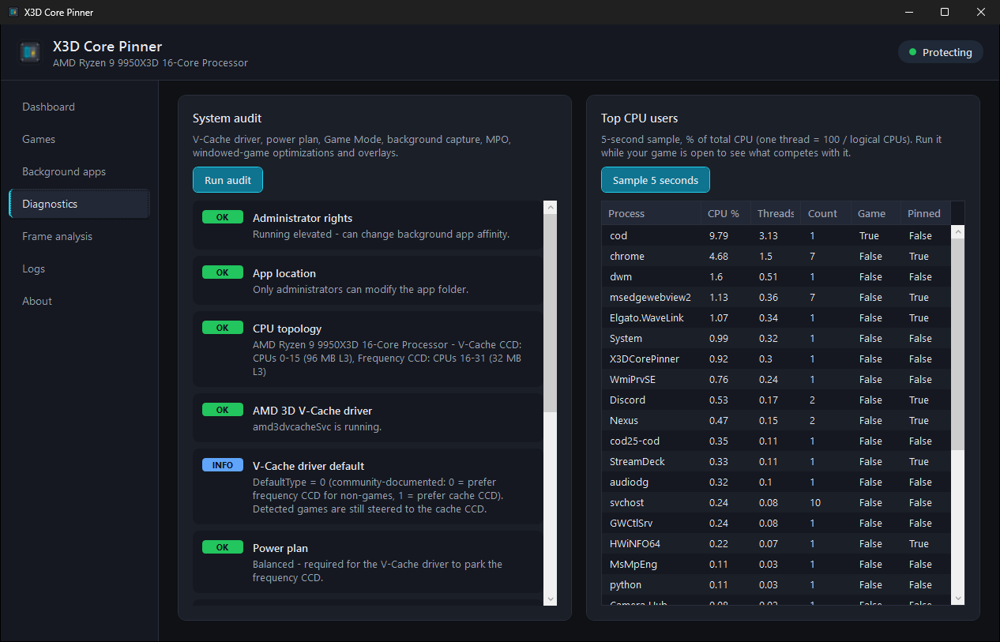
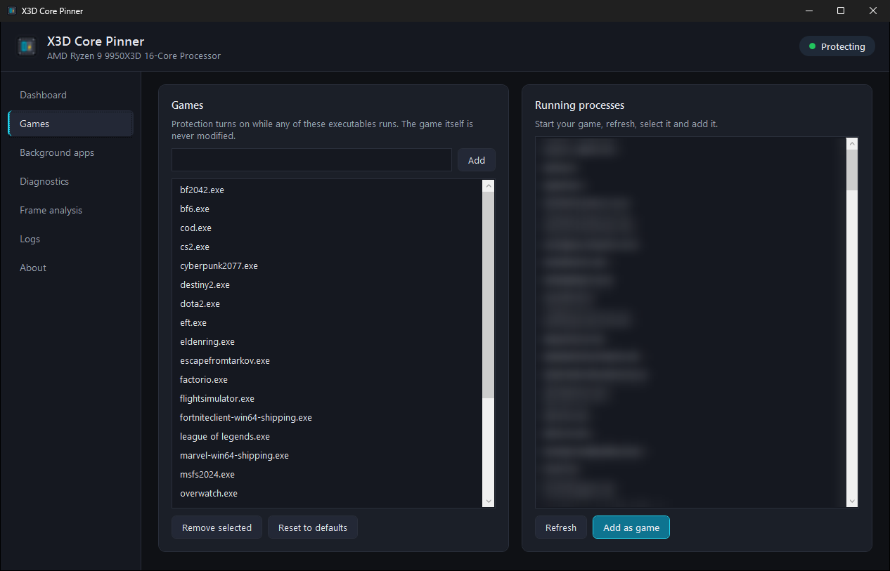
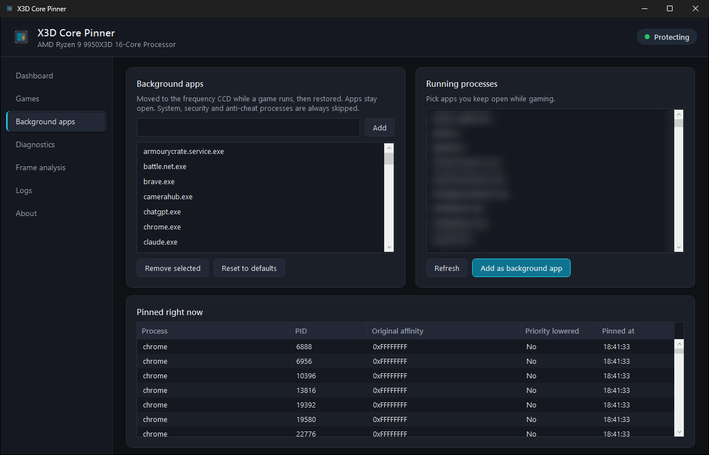
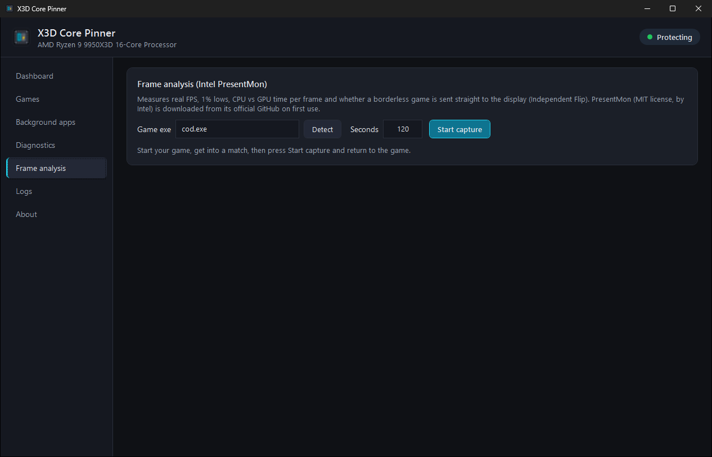
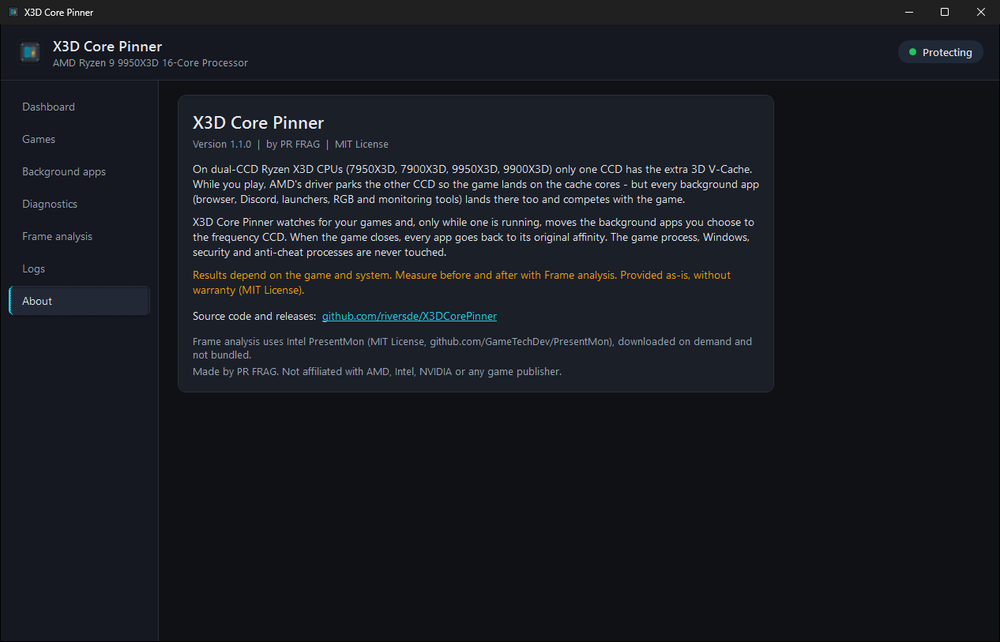

# X3D Core Pinner

**Keep the 3D V-Cache for your game.** On dual-CCD AMD Ryzen X3D CPUs, X3D Core Pinner moves your background apps (browser, Discord, launchers, RGB and monitoring tools) to the *frequency* CCD while you play, so they stop competing with the game on the *V-Cache* CCD. When the game closes, everything goes back exactly as it was.

Free and open source (MIT) - by **PR FRAG**.

  

---

## Why

A Ryzen 9 X3D has two CCDs: one with the extra 96 MB of 3D V-Cache, one without. When a game starts, AMD's *3D V-Cache Performance Optimizer* driver parks the frequency CCD so the game runs on the cache cores. That is good for the game, but every other running app is pushed onto the same 8 cores too. With a browser, Discord, launchers and hardware tools open, that is real competition for the cores your game depends on.

X3D Core Pinner fixes the second half: **only while a game you listed is running**, it restricts the background apps you listed to the frequency CCD, so the V-Cache CCD is left to the game.

## Features

- **Automatic protection** - watches for your games, pins background apps on launch, restores them on exit.
- **Real topology detection** - reads the L3 cache layout from Windows; no hard-coded core numbers.
- **Safe by design** - never touches the game, Windows core processes, security software or anti-cheat services. Each app's *original* affinity is saved and restored (also on pause, exit and Windows sign-out). An *Emergency restore* button resets everything at any time.
- **Tray app + notifications** - "Game cores protected", "Game session ended", and status in the tray tooltip.
- **Start with Windows** - elevated logon task, no UAC prompt at every boot.
- **Live CCD view** - load and core-parking percentage per CCD.
- **System audit** - V-Cache driver, power plan, Game Mode, background recording, MPO, windowed-game optimizations, overlays - with fixes.
- **Top CPU users** - see what competes with your game.
- **Frame analysis** - built-in Intel PresentMon capture: average FPS, 1% lows, CPU vs GPU time per frame, display latency, present mode (Independent Flip vs DWM composed) and a bottleneck verdict.
- **Portable** - single exe, no installer, no .NET install needed.

## Screenshots

| Dashboard | Diagnostics |
|---|---|
|  |  |
| **Games** | **Background apps** |
|  |  |
| **Frame analysis** | **About** |
|  |  |

## Requirements

- Windows 10 or 11 (x64)
- For pinning: AMD Ryzen **dual-CCD X3D** (7950X3D, 7900X3D, 9950X3D, 9900X3D) with the AMD chipset driver (3D V-Cache Performance Optimizer) installed and the **Balanced** power plan.
- Diagnostics and frame analysis work on any CPU.
- Administrator rights (Windows only allows elevated apps to change other apps' CPU affinity).

Single-CCD X3D chips (7800X3D, 9800X3D) do not need this: every core already has the V-Cache.

## Install and use

**Installer (recommended)**

1. Download `X3DCorePinner-vX.Y.Z-setup.exe` from **Releases** (optionally verify it against the `.sha256` file).
2. Run it. It installs to `C:\Program Files\X3DCorePinner` (admin-only - see [SECURITY.md](SECURITY.md)), adds a Start menu entry and, if you keep the box ticked, starts with Windows in the tray.
3. Upgrades: run a newer setup over the old one - your settings are kept. Uninstall from *Settings > Apps*; it restores every app's CPU affinity and removes the startup task.

**Portable ZIP**

Download `X3DCorePinner-vX.Y.Z-win-x64.zip` and extract it to `C:\Program Files\X3DCorePinner` (Start with Windows refuses user-writable folders). Settings stay in a `Data` folder next to the exe.

**First run**

1. **Dashboard** - check that your CPU shows a V-Cache CCD and a Frequency CCD.
2. **Games** - your game probably is already listed (CoD/Warzone, CS2, VALORANT, Fortnite, Apex, R6, Overwatch, Marvel Rivals, PUBG, Destiny 2 and more). If not, start the game, click *Refresh* and *Add as game*.
3. **Background apps** - add the apps you keep open while gaming.
4. Play. You get a notification when protection starts and when the session ends.

Closing the window keeps it running in the tray (configurable). Right-click the tray icon for *Pause*, *Emergency restore* and *Exit*.

### Measure it

Use **Frame analysis** in a real match, once with protection paused and once with it on, on the same map and mode. Results depend on the game and on how much runs in the background - expect the biggest difference when many apps are open. Measure, do not guess.

## FAQ

**Is it safe with anti-cheat?** The game process is never opened or modified, and anti-cheat services are on a built-in skip list. The app only changes the CPU affinity of *other* apps you listed, which is the same thing Task Manager's "Set affinity" does.

**What if X3D Core Pinner crashes while a game runs?** The pinned apps stay on the frequency CCD until each of them restarts. To put them back immediately, open X3D Core Pinner again and press *Emergency restore*.

**Is it safe to run with admin rights?** See [SECURITY.md](SECURITY.md): no telemetry, no data leaves your PC, the only network call is the optional PresentMon download from GitHub, and everything the app executes elevated is kept in admin-only folders.

**Why admin rights?** Windows requires them to change the affinity of processes you did not start from this app (for example services like RGB software).

**Where are settings stored?** In portable mode (the release ZIP ships with `portable.flag`), in a `Data` folder next to the exe. Delete `portable.flag` to use `%APPDATA%\X3DCorePinner` and `%LOCALAPPDATA%\X3DCorePinner` instead.

**Windows SmartScreen warns about the exe.** Releases are not code-signed yet. Verify the SHA-256 published with each release, or build it yourself.

## Build from source

```
winget install Microsoft.DotNet.SDK.8
git clone https://github.com/riversde/X3DCorePinner
cd X3DCorePinner
build.cmd
```

`build.ps1` runs the core self-tests, publishes a self-contained single-file exe and creates `dist\X3DCorePinner-v<version>-win-x64.zip`, and - if [Inno Setup 6](https://jrsoftware.org/isinfo.php) is installed (`winget install JRSoftware.InnoSetup`) - `dist\X3DCorePinner-v<version>-setup.exe`, each with a `.sha256`. Pushing a `v*` tag builds and publishes a GitHub release automatically (`.github/workflows/build.yml`).

### Project layout

| Path | What |
|---|---|
| `src/X3DCorePinner.Core` | Engine: topology (GetLogicalProcessorInformationEx), pinning engine, PDH CCD monitor, system audit, PresentMon service, startup task, config, logging |
| `src/X3DCorePinner` | WPF app: dark UI, tray icon, notifications |
| `installer/X3DCorePinner.iss` | Inno Setup script (Program Files install, startup task, clean uninstall) |
| `docs/Capture-Screenshots.ps1` | Re-creates the README screenshots (admin PowerShell, app installed) |
| `tests/CoreCheck` | Self-tests for config, task XML, command-line switches and frame-statistics math |

## Credits

- Frame analysis uses [Intel PresentMon](https://github.com/GameTechDev/PresentMon) (MIT), downloaded on demand from its official GitHub releases.
- Not affiliated with AMD, Intel, NVIDIA, Microsoft or any game publisher. Ryzen is a trademark of Advanced Micro Devices, Inc.

## License

MIT - see [LICENSE](LICENSE). Provided as-is, without warranty.
